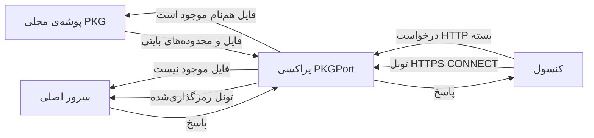

<div dir="rtl" align="right">

# راهنمای PKGPort

[English](README.md)

**فایل‌های PKG را از رایانه‌تان به کنسول برسانید.**

با PKGPort، کنسول فایل‌های بازی را از پوشه‌ی محلی رایانه می‌گیرد. برنامه درخواست‌های بسته‌ی پلی‌استیشن را از راه پراکسی تشخیص می‌دهد و فایل `.pkg` هم‌نام را می‌فرستد. در رابط برنامه هم می‌بینید چه بازی‌ای شناسایی شده، کدام بخش‌های بسته آماده‌اند و انتقال چطور پیش می‌رود.

**فناوری‌ها: Rust و GPUI Kit · سیستم‌عامل‌ها: لینوکس، ویندوز و macOS · زبان‌ها: فارسی و انگلیسی**

## دریافت برنامه

با هر push موفق، چهار فایل به پیش‌انتشار تازه‌ای اضافه می‌شود. در [صفحه‌ی Releases](https://github.com/miladmeidanshahi/pkg-port/releases)، جدیدترین مورد را باز کنید و فایل مناسب سیستم‌عاملتان را بردارید.

[](https://github.com/miladmeidanshahi/pkg-port/actions)
[](https://github.com/miladmeidanshahi/pkg-port/releases)

[](https://github.com/miladmeidanshahi/pkg-port/releases)
[](https://github.com/miladmeidanshahi/pkg-port/releases)
[](https://github.com/miladmeidanshahi/pkg-port/releases)
[](https://github.com/miladmeidanshahi/pkg-port/releases)

| سیستم‌عامل | نام فایل در صفحه‌ی انتشار |
| --- | --- |
| ویندوز x86_64 | `pkgport-<version>-windows-x86_64.exe` |
| لینوکس x86_64 | `pkgport-<version>-linux-x86_64.deb` |
| مک با Apple Silicon | `pkgport-<version>-macos-aarch64.dmg` |
| مک با پردازنده‌ی Intel | `pkgport-<version>-macos-x86_64.dmg` |

کنار فایل‌ها، `SHA256SUMS.txt` هم برای بررسی سالم بودن فایل‌های دانلودشده قرار می‌گیرد.

فایل‌ها فعلاً امضا نشده‌اند.

## توضیح برنامه

پراکسی را در تنظیمات کنسول وارد کنید و پوشه‌ی بسته‌ها را در PKGPort انتخاب کنید. حالا درخواست فایل را از کنسول شروع کنید. اگر فایل در پوشه باشد، PKGPort همان فایل را می‌فرستد؛ انتقالِ نیمه‌کاره هم با پشتیبانی از محدوده‌های بایتی می‌تواند ادامه پیدا کند. اگر فایل پیدا نشود، درخواست به سرور اصلی می‌رود.

جایگزینی فایل محلی فقط برای درخواست‌های بسته‌ی **HTTP** انجام می‌شود. درخواست‌های HTTPS رمزگشایی نمی‌شوند و در یک تونل امن عبور می‌کنند؛ در نتیجه PKGPort نمی‌تواند فایل‌های آن‌ها را جایگزین کند.

## نمای کلی

| مرحله | کار شما | چیزی که PKGPort نشان می‌دهد |
| --- | --- | --- |
| ۱. پراکسی | رابط شبکه را انتخاب و پراکسی را روشن کنید. | نشانی، درگاه، وضعیت اتصال و گزارش درخواست‌ها |
| ۲. محتوای بازی | درخواست بسته را از کنسول شروع کنید. | عنوان شناسایی‌شده، منطقه، نشانی‌های بسته و کشف بخش‌ها |
| ۳. پوشه‌ی PKG | پوشه‌ی فایل‌های کامل `.pkg` را انتخاب کنید. | تعداد فایل‌ها و بخش‌های موجود از بسته‌ی درخواستی |
| ۴. انتقال به کنسول | هنگام درخواست فایل‌ها، پراکسی را روشن نگه دارید. | درخواست فعلی، وضعیت فایل‌ها، حجم ارسال‌شده و سرعت انتقال |

می‌توانید رابط را فارسی یا انگلیسی کنید. در حالت فارسی، چیدمان هم راست‌چین می‌شود.

## روش کار



پراکسی روی رابط شبکه‌ای که انتخاب کرده‌اید گوش می‌دهد و به دستگاه‌های زیرشبکه‌های خصوصی IPv4 شناسایی‌شده پاسخ می‌دهد. درخواست HTTP از درگاه ۸۰ عبور می‌کند؛ HTTPS هم روی درگاه ۴۴۳، بدون رمزگشایی، در تونل CONNECT می‌ماند. PKGPort درخواست‌های HTTP به `gst.prod.dl.playstation.net` را برای پیدا کردن فایل محلی بررسی می‌کند. اسم باید دقیقاً یکی باشد. فایل نبود؟ درخواست به سرور اصلی می‌رود.

وقتی بازی شناسایی شود، PKGPort نام و تصویرش را با شناسه‌ی عنوان پیدا می‌کند. برای پیدا کردن بخش‌های شماره‌دار بسته، نشانی‌ها را یکی‌یکی امتحان می‌کند و با اولین بخشِ پیدا نشده می‌ایستد. این بررسی به `curl` نیاز دارد و برای بعضی نشانی‌های دارای پارامتر ممکن است همه‌ی بخش‌ها را پیدا نکند.

<details>
<summary><strong>درخواست‌های HTTPS چه می‌شوند؟</strong></summary>

برای HTTPS، PKGPort فقط یک تونل رمزگذاری‌شده‌ی CONNECT می‌سازد. مسیر درخواست برایش قابل‌خواندن نیست و فایل محلی را جایگزین نمی‌کند. ضمن این‌که بعضی سرویس‌های کنسول ممکن است اصلاً از پراکسی عبور نکنند.

</details>

## شروع سریع

### پیش‌نیازها

- نسخه‌ی **۱.۹۲ یا جدیدتر Rust** و [پیش‌نیازهای GPUI Kit](https://gpui-kit.com/docs/installation/).
- محیط گرافیکی دسکتاپ. در لینوکس، درایور Vulkan و کتابخانه‌های توسعه‌ی فهرست‌شده در ادامه لازم‌اند.
- ابزار `curl` برای دریافت اطلاعات بازی و بررسی آنلاین بخش‌های بسته.
- کنسولی که از پراکسی شبکه پشتیبانی کند و در شبکه‌ی محلی به رایانه دسترسی داشته باشد.

### اجرا از روی کد

```sh
cargo run --locked
```

۱. در بخش **Proxy**، رابط شبکه‌ی متصل به کنسول را انتخاب کنید و پراکسی را روشن کنید.
۲. نشانی IPv4 محلی رایانه و درگاهی را که برنامه نشان می‌دهد در تنظیمات کنسول وارد کنید. `0.0.0.0` نشانیِ قابل‌استفاده در کنسول نیست.
۳. درخواست بسته را از کنسول شروع کنید. بازی شناسایی‌شده و نشانی‌هایش را در **Game content** می‌بینید.
۴. در **PKG folder**، پوشه‌ی فایل‌های کامل `.pkg` را انتخاب کنید. نام فایل‌ها باید با درخواست کنسول یکی باشد.
۵. وضعیت درخواست‌ها را در **Upload to console** دنبال کنید و تا پایان انتقال، پراکسی را روشن بگذارید.

فایروال رایانه باید اجازه‌ی اتصال به درگاه انتخاب‌شده را بدهد. وقتی کارتان تمام شد، پراکسی را خاموش کنید. تا آن موقع، دستگاه‌های دیگر در زیرشبکه‌های محلی شناسایی‌شده هم ممکن است به آن دسترسی داشته باشند.

<details>
<summary><strong>پیش‌نمایش برنامه بدون کنسول</strong></summary>

برای دیدن رابط بدون کنسول، این دستور را در نسخه‌ی توسعه اجرا کنید. پیش‌نمایش، بازی و شناسه‌ی واقعی دارد؛ نشانی‌های بسته، فایل‌ها، دستگاه و انتقال فقط شبیه‌سازی می‌شوند. دفعه‌ی بعد که برنامه را اجرا می‌کنید، متغیر را بردارید تا پیش‌نمایش خاموش شود.

```sh
PKGPORT_DEV_MOCK=1 cargo run
```

</details>

## امکانات

- **فایل‌های محلی:** فایل هم‌نام را می‌فرستد، ادامه‌ی انتقال HTTP را پشتیبانی می‌کند و اگر فایل را نداشته باشید درخواست را به سرور اصلی می‌سپارد.
- **جزئیات بازی:** شناسه، نام، تصویر، منطقه و نشانی بخش‌های بسته را هرجا در دسترس باشند نشان می‌دهد.
- **روند انتقال:** درخواست فعلی، وضعیت تک‌تک فایل‌ها، حجم ارسال‌شده و سرعت را می‌بینید.
- **کنترل‌های دسکتاپ:** وضعیت پراکسی و درخواست‌های اخیر جلوی چشم‌اند؛ نشانی‌ها را هم می‌توانید کپی کنید. در لینوکس، برنامه از سینی سیستم هم باز می‌شود.
- **فارسی و انگلیسی:** زبان رابط را عوض کنید؛ چیدمان فارسی راست‌چین است.
- **تنظیمات ذخیره‌شده:** پوشه، رابط شبکه، نشانی اتصال، درگاه و زبان برای اجرای بعدی می‌مانند.

## ساخت و نصب

## ساخت از روی کد

برای ساخت نسخه‌ی بهینه:

```sh
cargo build --locked --release
```

فایل اجرایی در لینوکس و macOS در `target/release/pkgport` و در ویندوز در `target/release/pkgport.exe` ساخته می‌شود. با هر push، GitHub Actions پروژه را آزمایش و برای هر چهار پلتفرم بسته‌بندی می‌کند. می‌توانید ساخت را دستی هم از صفحه‌ی **Actions** مخزن شروع کنید.

در لینوکس، پس از ساخت برنامه این دستور را بزنید تا راه‌انداز و آیکن نصب شوند:

```sh
./scripts/install-desktop.sh
```

نصاب، فایل اجرایی را در `~/.local/bin/pkgport` می‌گذارد. اگر برنامه را از منوی برنامه‌ها باز می‌کنید، بعد از تغییر کد آن را دوباره بسازید تا نسخه‌ی تازه اجرا شود.

<details>
<summary><strong>وابستگی‌های ساخت در لینوکس</strong></summary>

در اوبونتو ۲۴.۰۴:

```sh
sudo apt update
sudo apt install -y gcc g++ clang libfontconfig-dev libwayland-dev \
  libwebkit2gtk-4.1-dev libxkbcommon-x11-dev libx11-xcb-dev \
  libssl-dev libzstd-dev libasound2-dev vulkan-validationlayers libvulkan1
```

در توزیع‌های دیگر، بسته‌های هم‌ارز را نصب کنید. برای ویندوز، زنجیره‌ابزار MSVC در Rust، ابزارهای ساخت C++ ویژوال استودیو، Windows SDK و CMake لازم است. در macOS، Xcode Command Line Tools را نصب کنید.

</details>

## پرسش‌های رایج

<details>
<summary><strong>چرا بازی شناسایی نمی‌شود؟</strong></summary>

اول مطمئن شوید پراکسی روشن است و نشانی IPv4 محلی رایانه و درگاه درست را در کنسول وارد کرده‌اید. بعد بررسی کنید درخواست بسته واقعاً از پراکسی رد می‌شود؛ بعضی سرویس‌های کنسول تنظیم پراکسی را نادیده می‌گیرند.

</details>

<details>
<!-- fa-lint-ignore-next-line -->
<summary><strong>پرسش: چرا بسته هنوز از اینترنت دریافت می‌شود؟</strong></summary>

برای فرستادن فایل از رایانه، درخواست باید HTTP باشد و اسم فایل در پوشه دقیقاً با اسم درخواستی یکی باشد. اگر فایل را نداشته باشید، درخواست به سرور اصلی می‌رسد. بسته‌های HTTPS هم رمزگذاری‌شده‌اند و با فایل محلی جایگزین نمی‌شوند.

</details>

## توسعه

```sh
cargo fmt --check
cargo test --locked
cargo clippy --locked --all-targets -- -D warnings
```

رابط با [GPUI Kit](https://gpui-kit.com/) ساخته شده و متن‌های فارسی و انگلیسی در [`locales/ui.yml`](locales/ui.yml) هستند. بازرس عناصر GPUI Kit در نسخه‌ی توسعه با **Ctrl+Shift+I** در لینوکس و ویندوز، و با **Cmd+Option+I** در macOS باز می‌شود.

## مشارکت

باگ پیدا کردید یا می‌خواهید مشارکت کنید؟ از بخش Issues یا Pull requests در [مخزن GitHub](https://github.com/miladmeidanshahi/pkg-port) پیام بگذارید. برای مشکل انتقال، نام سیستم‌عامل، نسخه‌ی برنامه و مراحلی را که مشکل را ایجاد می‌کنند بنویسید. نشانی‌های خصوصی و نشانی دستگاه‌ها را پیش از ارسال پاک کنید.

## مجوز

فعلاً مجوزی برای خود پروژه در مخزن نگذاشته‌ایم. قلم‌های همراه برنامه مجوز جداگانه دارند؛ متن آن‌ها در [`assets/fonts/`](assets/fonts/) است.

</div>
