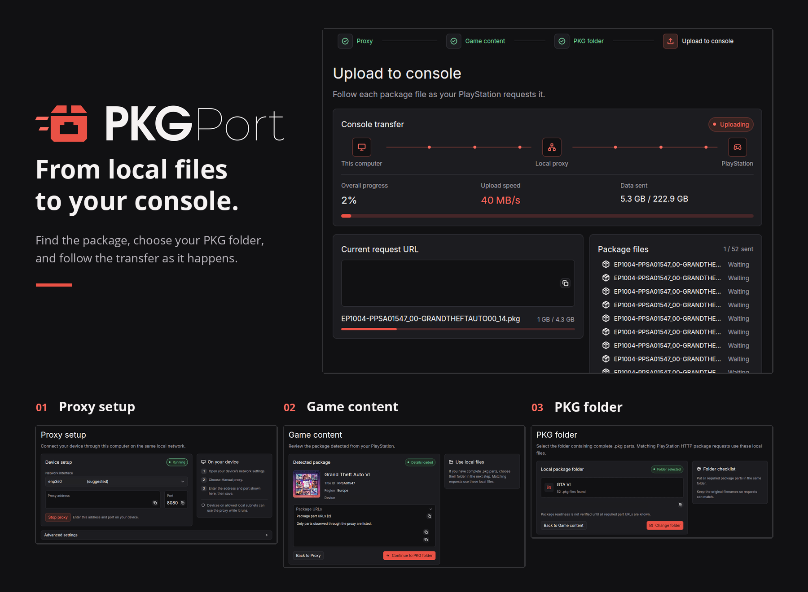
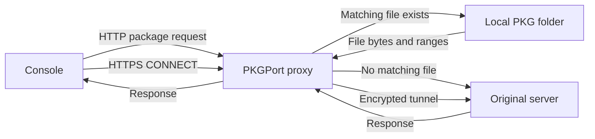

# PKGPort

[فارسی](README.fa.md)

**Give your local PKG files a route to your console.**

PKGPort is a desktop app for ultra-fast local PlayStation package transfers. It runs a local proxy, recognizes package requests, and streams matching `.pkg` files straight from a folder on your computer. Its guided interface shows the detected game, checks package parts, and tracks transfer progress.

**Rust + GPUI Kit · Linux, Windows, macOS · English and Persian**

[How it works](#how-it-works) · [Quick start](#quick-start) · [Build and install](#build-and-install) · [FAQ](#faq)

[](https://github.com/miladmeidanshahi/pkg-port/actions)
[](https://github.com/miladmeidanshahi/pkg-port/releases)

## Downloads

Each successful push publishes a prerelease with all four builds. Pick the newest entry on the [Releases page](https://github.com/miladmeidanshahi/pkg-port/releases), then download the file for your system.

[](https://github.com/miladmeidanshahi/pkg-port/releases)
[](https://github.com/miladmeidanshahi/pkg-port/releases)
[](https://github.com/miladmeidanshahi/pkg-port/releases)
[](https://github.com/miladmeidanshahi/pkg-port/releases)

| Platform | Release file |
| --- | --- |
| Windows x86_64 | `pkgport-<version>-windows-x86_64-setup.exe` |
| Linux x86_64 | `pkgport-<version>-linux-x86_64.deb` |
| macOS Apple Silicon | `pkgport-<version>-macos-aarch64.dmg` |
| macOS Intel | `pkgport-<version>-macos-x86_64.dmg` |

Each release also includes `SHA256SUMS.txt` to check downloaded files.

All builds are currently unsigned.

## Description

Set the proxy on your console, point PKGPort at your downloaded package folder, and let the console request the files. When a package request matches a local file, PKGPort streams that file, including supported byte ranges for resumed transfers. Other requests continue to their original destination.

PKGPort works with **HTTP package requests**. It tunnels HTTPS without decrypting it, so HTTPS package downloads cannot be replaced with local files.

## At a glance

| Step | What you do | What PKGPort shows |
| --- | --- | --- |
| 1. Proxy | Choose a network interface and start the proxy. | Address, port, connection status, and request logs. |
| 2. Game content | Let the console request a game package. | Detected title, region, package URLs, and part discovery. |
| 3. PKG folder | Select the folder containing complete `.pkg` files. | File count and how many required parts are present. |
| 4. Upload to console | Keep the proxy running while the console requests files. | Current request, package states, bytes sent, and transfer speed. |

The wizard supports English and Persian, including an RTL layout.

## How it works



PKGPort listens on your selected computer interface. It accepts devices on detected local private IPv4 subnets, forwards HTTP requests on port 80, tunnels HTTPS with CONNECT on port 443, and intercepts matching HTTP package requests for `gst.prod.dl.playstation.net`. Files are matched by their **exact filename**. A missing local file falls back to the original server.

For a detected title, the app looks up the game name and cover using its title ID. Numbered package part discovery checks successive URLs and stops at the first missing part. This discovery needs `curl` and may be incomplete for URLs that require query parameters.

<details>
<summary><strong>What happens to HTTPS requests?</strong></summary>

PKGPort uses an encrypted CONNECT tunnel. It cannot read HTTPS paths or substitute local files for HTTPS package downloads. The console may also ignore proxy settings for some services.

</details>

## Quick start

### Requirements

- Rust **1.92+** and the [GPUI Kit platform prerequisites](https://gpui-kit.com/docs/installation/).
- A graphical desktop session. Linux needs a working Vulkan driver and the development libraries listed below.
- `curl` for game metadata lookup and online package part discovery.
- A console you control that supports a network proxy, on a reachable local network.

### Run from source

```sh
cargo run --locked
```

1. In **Proxy**, select the network interface connected to the console and start the proxy.
2. On the console, set its proxy host to the computer's displayed **LAN IPv4 address** and use the displayed port. `0.0.0.0` is a listen address, not the address to enter on the console.
3. Start a package request on the console. In **Game content**, inspect the detected title and package URLs.
4. In **PKG folder**, choose the folder holding the complete, correctly named `.pkg` parts.
5. In **Upload to console**, follow the requests and transfer status. Keep the proxy running until the console finishes.

The computer's firewall must allow the selected port. Stop the proxy when you are done: other devices on detected local subnets may be able to use it while it runs.

<details>
<summary><strong>Preview the wizard without a console</strong></summary>

In a debug build, run `PKGPORT_DEV_MOCK=1 cargo run`. The preview uses a real game title and ID with simulated package URLs, local files, device address, and transfer progress. The setting is temporary; omit the variable on the next run to turn it off.

</details>

## Features

- **Local file serving:** Exact filename matching, HTTP byte ranges, and fallback to the original server.
- **Game details:** Title ID, name, cover, region, and numbered package URLs when available.
- **Transfer view:** Current request, per-file state, total bytes sent, and upload speed.
- **Desktop controls:** Proxy status, recent request logs, copyable addresses and URLs, and Linux tray activation.
- **Language support:** English and Persian with an RTL interface.
- **Saved setup:** Folder, interface, bind address, port, and language are stored in `settings.json` under the platform config directory and preserved across app updates.

## Build and install

### Build from source

Build the optimized executable:

```sh
cargo build --locked --release
```

The binary is `target/release/pkgport` on Linux and macOS, or `target/release/pkgport.exe` on Windows. Every push starts a GitHub Actions build that tests and packages all four platforms. You can also start a build manually from the repository’s **Actions** page.

On Linux, install the `.deb` package from the Releases page to add the app menu launcher and icon. A locally built binary can be run directly from `target/release/pkgport`.

<details>
<summary><strong>Linux build dependencies</strong></summary>

On Ubuntu 24.04:

```sh
sudo apt update
sudo apt install -y gcc g++ clang libfontconfig-dev libwayland-dev \
  libwebkit2gtk-4.1-dev libxkbcommon-x11-dev libx11-xcb-dev \
  libssl-dev libzstd-dev libasound2-dev vulkan-validationlayers libvulkan1
```

Other distributions need equivalent libraries. On Windows, use the MSVC Rust toolchain, Visual Studio C++ build tools, a Windows SDK, and CMake. On macOS, install Xcode Command Line Tools.

</details>

## FAQ

<details>
<summary><strong>Why is no game detected?</strong></summary>

Check that the proxy is running, the console points to the computer's LAN IPv4 address and selected port, and its package request goes through that proxy. Some console services may bypass the configured proxy.

</details>

<details>
<summary><strong>Why is a package still coming from the internet?</strong></summary>

PKGPort needs an HTTP package request and a file with the exact requested filename in the selected folder. Missing files fall back to the original server. HTTPS packages stay encrypted and cannot be replaced locally.

</details>

## Development

```sh
cargo fmt --check
cargo test --locked
cargo clippy --locked --all-targets -- -D warnings
```

The UI is built with [GPUI Kit](https://gpui-kit.com/). Translations are in [`locales/ui.yml`](locales/ui.yml). In a debug build, press **Ctrl+Shift+I** on Linux or Windows, or **Cmd+Option+I** on macOS, for GPUI Kit's element inspector.

## Contributing

Contributions and bug reports are welcome through GitHub issues and pull requests. When reporting a transfer problem, include the OS, app version, and steps to reproduce; remove private URLs and device addresses from logs first.

## License

There is currently no project license file. The bundled fonts have their own licenses in [`assets/fonts/`](assets/fonts/).
